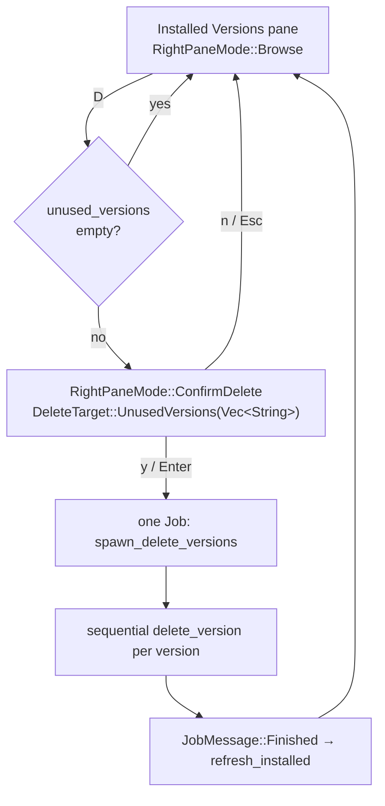

# Prune Unused Versions

A one-keystroke bulk cleanup in the [[Installed Versions and Sites Panel]]: press **`D`** (Shift+D) while the Installed Versions pane is focused to remove every installed Checkmk version that nothing is using.

Dev machines accumulate daily builds fast — each one is a multi-GB `/omd/versions/` directory plus an apt package. Deleting them one at a time with `d` is the slow path; `D` is the "reclaim the disk" path.

---

## What Counts as "Unused"

A version is a prune candidate only when **both** are true:

| Guard | Why |
|-------|-----|
| No OMD site runs it | Deleting a version out from under a live site breaks that site |
| It is not omd's default version | `/omd/versions/default` points at it; bare `omd create` needs it |

Everything else is fair game. The rule lives in one place — `installer::unused_versions()` — so the count shown in the UI and the set actually deleted can never disagree:

```rust
pub fn unused_versions(
    installed: &[String],
    sites: &[InstalledSite],
    default_version: Option<&str>,
) -> Vec<String>
```

The comparison is an exact string match after trimming, which works because `omd versions -b` and the VERSION column of `omd sites` print the identical format:

```
omd versions -b  →  3.0.0-2026.07.20.ultimate
omd sites        →  ultimate   3.0.0-2026.07.20.ultimate
```

See [[omd]] for the full output formats.

---

## Visual Markers

Every row in the pane is marked so the effect of `D` is known *before* pressing it:

```
┌ Installed Versions (1 unused) ───────┐
│ ● 2.4.0p24.cee                       │  ● in use by a site  → protected
│ ★ 2.5.0b3.cre                        │  ★ omd default       → protected
│ ○ 2.6.0-2026.03.31.cee               │  ○ unused            → prune candidate
└──────────────────────────────────────┘
```

The pane title carries the candidate count. When it reads plain `Installed Versions`, there is nothing to prune and `D` deliberately does nothing — no prompt, no error. Discoverability comes from the title, not from an error message.

---

## Flow



The candidate list is captured into `DeleteTarget::UnusedVersions` **when the prompt opens**, not re-derived on confirm. A [[Background Refresh]] landing between the keypress and the `y` therefore cannot change the set out from under the user — what they confirm is what they were shown.

---

## Why One Job, Sequentially

`spawn_delete_versions()` removes every version inside a **single** [[Log Panel]] job, one after another:

```rust
for (i, version) in versions.iter().enumerate() {
    // "── [2/7] 3.0.0-2026.07.06.ultimate ──"
    if !delete_version(version, job_id, &tx).await {
        failed.push(version);
    }
}
```

Two reasons this is not parallel:

1. **apt holds an exclusive lock.** Each removal may run `apt-get purge`; two purges at once fail with `could not get lock /var/lib/dpkg/lock`.
2. **One job, one log tab.** A prune of 12 versions as 12 concurrent jobs would flood the tab bar. One `prune 12` tab with a per-version `[n/total]` header stays readable.

The job succeeds only if every removal succeeded; failures are listed at the end rather than aborting the run, so one bad version doesn't block the rest.

`delete_version()` is the shared per-version helper — the same `rm -rf` + `dpkg -l` + `apt-get purge` sequence used by the single-version `d` delete. Neither the single nor the batch path sends `JobMessage::Finished` from the helper; the caller does, so a batch reports one result for the whole run.

---

## Keybinding

| Key | Pane | Action |
|-----|------|--------|
| `d` | Installed Versions | Delete the selected version |
| `D` | Installed Versions | Prune all unused versions |
| `s` | Installed Versions | Create a site from the selected version |

Shift+D arrives as `KeyCode::Char('D')`, distinct from `Char('d')`, so no modifier check is needed — unlike Ctrl+h/j, which terminals mangle (see [[Crossterm]]).

---

## Rust Concepts Here

- **`HashSet<&str>` of borrowed strings** — O(1) "is this version in use?" without cloning every site version. The set borrows from `sites`, so it cannot outlive them.
- **`Option<&str>` parameter** — `default_version.as_deref()` turns `&Option<String>` into `Option<&str>`, the idiomatic read-only form. See [[Rust Option Type]].
- **Enum variant carrying a payload** — `DeleteTarget::UnusedVersions(Vec<String>)` stores the whole candidate list in the state machine. See [[Rust Enums and Algebraic Data Types]] and [[App State Machine]].
- **Slices over owned Vecs** — `unused_versions()` takes `&[String]` so the caller keeps ownership. See [[Rust Ownership and Borrowing]].

---

## Tests

`installer::tests` covers the rule as a pure function: versions backing a site are excluded, the default version is excluded, whitespace is ignored, and an empty site list means everything is a candidate.

`ui::render::tests` renders the pane into a Ratatui `TestBackend` buffer and asserts the `●` / `★` / `○` markers and the `(N unused)` title — no TTY and no subprocesses needed. See [[Testing Workflow]].

---

## Metadata

**Tags:** feature
**Related:** [[Installed Versions and Sites Panel]], [[omd]], [[Log Panel]], [[App State Machine]], [[Background Refresh]], [[cmk-dev-install]]
